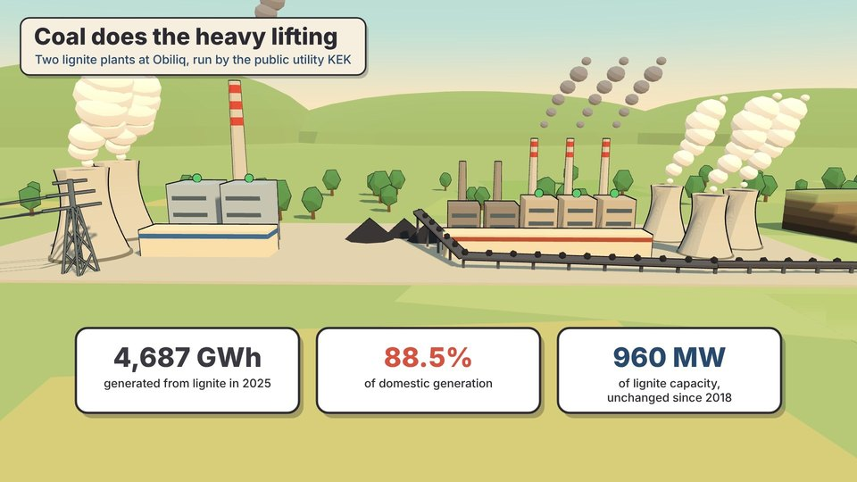
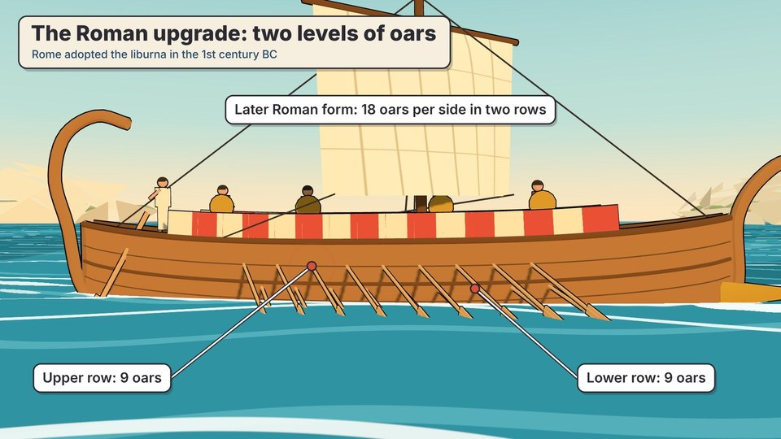
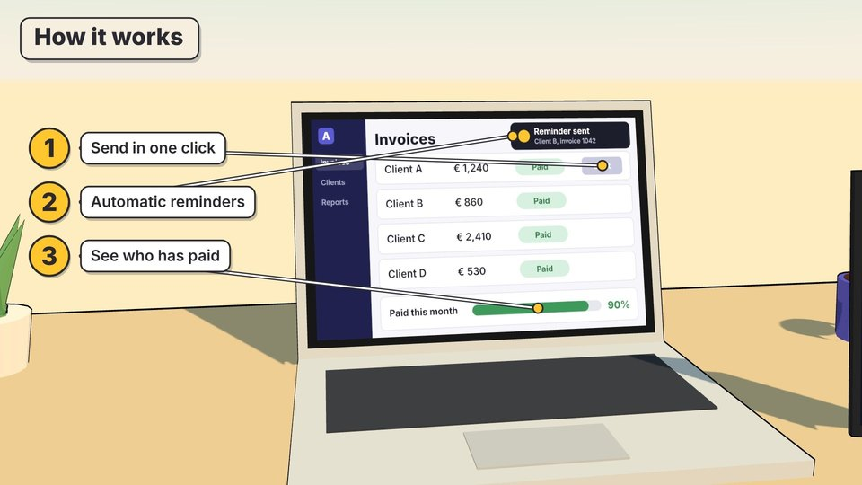
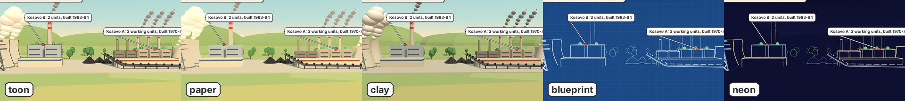

# explainer-films

Narrated explainer, engineering and sales videos made entirely in code. You write a script, the narrator's timing drives the animation, and a browser renders every frame. No video editor, no stock footage, no generative video model.

| Explainer | Engineering | Sales |
|---|---|---|
|  |  |  |
| Data and how things work: maps, plants, counters, charts. Example: [`films/kosovo-electricity`](films/kosovo-electricity) (2 min 56 s) | Objects and mechanisms: anatomy, cross-sections, dimensions. Example: [`films/liburna`](films/liburna) (2 min 4 s) | Product stories: problem, live interface, features, call to action. Example: [`films/acme-sales`](films/acme-sales) (32 s, placeholder brand) |

## How it works

1. **Script.** `script.json` holds what the narrator says, split into phrases.
2. **Narration and cues.** A local text-to-speech model reads each phrase and records when it starts. Those times are saved to `cues.json`.
3. **Scenes in code.** Each scene is a JavaScript function that draws one frame for a given time. It reads the cue times, so a label appears on the word that names it. Change the script and the animation follows.
4. **Render and sound.** A headless browser draws the frames, ffmpeg encodes them, and music and sound effects are synthesized and mixed under the voice.

Everything is deterministic: the same inputs give the same video, frame for frame.

## Quick start

You need Node 18 or newer, Python 3.10 or newer, and ffmpeg.

```bash
npm install
pip install -r requirements.txt
python3 -m playwright install chromium

npm run preview starter        # opens a live preview in your browser, with a timeline scrubber
npm run film starter           # narration, render, sound and final mp4 in films/starter/out/
```

The first narration run downloads the voice model (about 340 MB) to `~/.cache/explainer-films`.

## Your first film

```bash
npm run new my-film                 # or: npm run new my-film sales | explainer | engineering
```

1. **Write the script** in `films/my-film/script.json`. One list of phrases per scene. A phrase is the unit you can time things to.
2. **Generate the voice:** `npm run narrate my-film`. This writes `cues.json`.
3. **Build the scenes** in `films/my-film/film.js` with `npm run preview my-film` open. Edit, reload, scrub.
4. **Check still frames** before any long render: `npm run still my-film intro:3.5 numbers:6`. The preview shows the `scene:seconds` readout to copy from.
5. **Finish:** `npm run film my-film -- --skip-narration` renders every scene, builds the sound and writes `films/my-film/out/my-film.mp4`.

Changed one scene? `npm run render my-film intro` re-renders only that scene, then `npm run mix my-film` rebuilds the final file without re-encoding the rest.

## Styles

The same film can be rendered in five looks. Models and animation stay the same; materials, outlines and backdrop change.



| Style | Look | Notes |
|---|---|---|
| `toon` | Three-step shading with ink outlines | Default |
| `paper` | Nearly flat colour with soft shadows, no outlines | |
| `clay` | Smooth soft shading, no outlines | |
| `blueprint` | White line drawing on blue with a grid | Only outlined models are drawn |
| `neon` | Coloured lines on a dark backdrop | Only outlined models are drawn |

```bash
npm run preview kosovo-electricity blueprint
npm run film kosovo-electricity -- --style blueprint
```

Add your own in [`engine/styles.js`](engine/styles.js).

## What is in the repo

```
engine/
  core.js        renderer, materials, outlines, sky, camera keyframes, easing
  stage.js       environments, sun, ground, frame output, play()
  overlay.js     2D graphics: headers, labels, callouts, cards, bars, wipes
  styles.js      style presets
  parts/         reusable models: kit (boxes, cylinders), energy (cooling towers, stacks, pylons,
                 turbines, smoke, hills, trees), sea (water, hulls, oars, sails, crew),
                 devices (laptop and phone with drawable screens, desk props)
films/
  starter/              two scenes that show the whole workflow
  kosovo-electricity/   explainer example
  liburna/              engineering example
  acme-sales/           sales template with a placeholder brand
tools/
  narrate.py  still.py  render.py  mix.py  make.py  synth.py  preview.js  new.js
skills/explainer-film/  instructions for AI coding agents
docs/api.md             reference for the engine and parts
```

A film is a folder: `script.json`, `cues.json`, `film.js`, an optional `audio.py`, and any data it needs. Generated files (`narr/`, `out/`) are not committed.

## Using it with an AI coding agent

The scenes are code, so a coding agent can write them. [`AGENTS.md`](AGENTS.md) and [`skills/explainer-film/SKILL.md`](skills/explainer-film/SKILL.md) describe the procedure: research and verify the facts, write the script, generate cues, build scenes against the cues, check still frames, then render. With those loaded you can ask for "a three-minute explainer about X" and get a film folder back.

Both long examples in this repo were made that way.

## Speed

Frames are drawn by a real browser. `tools/render.py` draws on the CPU by default, which works on any machine, including servers with no graphics card. On a 2-core cloud machine the examples render at roughly one frame per second per worker, so the three-minute film takes about 35 minutes.

Pass `--gpu` to use your graphics card instead. That path has not been measured yet, because the films were authored on a machine without one. Reports are welcome.

## Limits

- Output is 1920 x 1080. Vertical and square formats are planned; overlay layouts are written in pixels for now.
- The style is illustrative, not photoreal.
- The parts library covers what the examples needed. A specific product, machine or interface still has to be modelled for each film.
- The bundled voices cover English and a few other languages. Check that the voice model handles your language before writing a script for it.
- The two line styles (`blueprint`, `neon`) skip models that have no outline, such as hills and decorative stripes.

## Accuracy

An explainer is only as good as its numbers. Each example keeps its sources next to the film (`SOURCES.md`) and shows them on screen. The sales template uses a made-up brand and labels its figures as placeholders: replace them with claims you can back up.

## Licence

Code is MIT, see [`LICENSE`](LICENSE). Bundled and downloaded third-party pieces are listed in [`THIRD_PARTY.md`](THIRD_PARTY.md).
